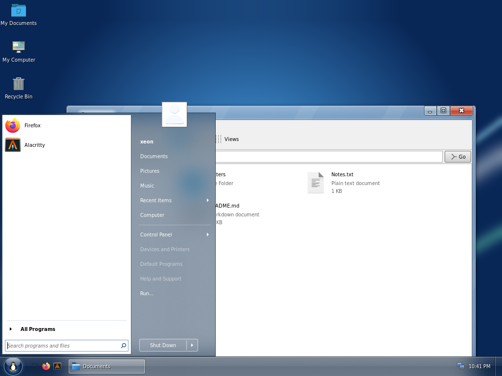
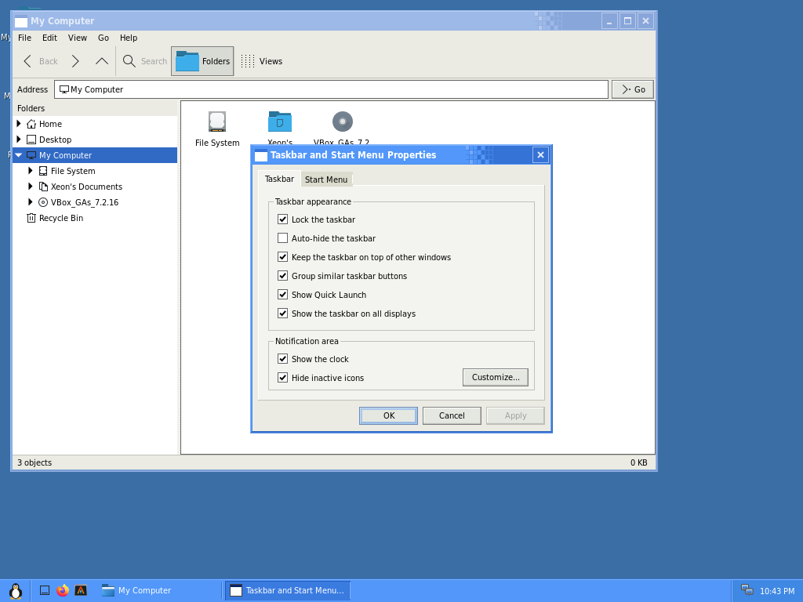
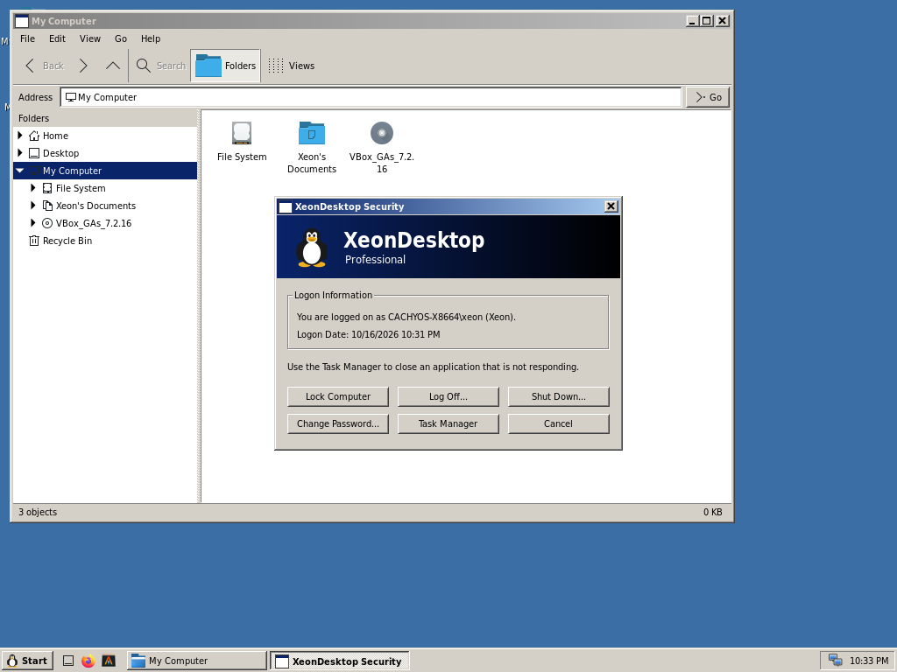

# XeonDesktop

A Windows 2000, XP and 7-style desktop environment for Linux (Wayland),
written in strict C23. See [docs/ARCHITECTURE.md](docs/ARCHITECTURE.md) for
the design.

| Classic (Windows 2000) | Luna (XP) |
|---|---|
|  |  |
| **Aero (Windows 7)** | **Aero Snap** |
|  |  |
| **Watercolor (Whistler)** | **Display Properties** |
|  |  |
| **Shut Down** | **Windows Security (Ctrl+Alt+Delete)** |
|  |  |

All artwork is drawn by the theme engine; no Microsoft assets are used.
The Time Zone map draws Natural Earth's land outlines (public domain,
naturalearthdata.com).
The Start button logo is Tux, the Linux mascot originally drawn by Larry
Ewing (lewing@isc.tamu.edu) with The GIMP; ours is a simplified procedural
rendition. Screenshots are from headless test sessions at 1024x768; the
Aero ones use the GPU build (blurred glass), and their wallpaper is a
gradient made for them.

## Build

Dependencies: meson, ninja, wlroots 0.20, wayland and wayland-protocols,
xkbcommon, xcb and xcb-icccm, cairo, pango, GLib/GIO, GTK 3, gdk-pixbuf,
procps-ng's libproc2 (Task Manager), PAM (Lock Computer), libudev (Device
Manager) and polkit's agent library. At run time, Xwayland
(`xorg-xwayland`) runs X11 applications; without it only Wayland ones work.
Fonts: Windows' fonts are replaced by the closest freely packaged ones,
DejaVu Sans Condensed for Tahoma (its width and shapes), Source Sans 3 for
Trebuchet MS (Luna captions) and Roboto Condensed for Franklin Gothic (XP's
Start button): `ttf-dejavu`, `adobe-source-sans-fonts` and `ttf-roboto` on
Arch, `fonts-dejavu-extra`, `fonts-adobe-sourcesans3` and
`fonts-roboto-unhinted` on Debian. The real fonts are used if installed.

    meson setup build          # debug build with ASan/UBSan
    ninja -C build
    meson test -C build

Release build: `meson setup build-release -Dbuildtype=release -Db_sanitize=none`.
Static analysis: `meson setup build-analyze -Danalyzer=true`.

## Packages

GitHub Actions (`.github/workflows/packages.yml`) builds a `.deb` for Debian
testing and unstable (wlroots 0.20 isn't in a stable release yet) and a
package for Arch Linux and CachyOS on every push; they're under the run's
Artifacts, and tagging `vX.Y.Z` attaches them to a release. To build them
locally with podman (or docker):

    podman run --rm -v "$PWD":/src -w /src debian:testing packaging/build-deb.sh
    podman run --rm -v "$PWD":/src -w /src cachyos/cachyos packaging/build-arch.sh

The packages land in `dist/`. Installing one adds **XeonDesktop** to the
display manager's session list (`xeondesktop-session`, which reads
`~/.config/environment.d` and starts the compositor).

## Run the compositor

Nested in an existing X11 or Wayland session (opens a window), or from a TTY:

    ./build/xd-compositor --style classic|luna|whistler [--scheme FILE] [--scale 1.5] -s alacritty

The compositor starts `xd-shell` (the taskbar) itself, passing on the style
and scheme, and restarts it if it crashes. Use `--no-shell` to skip it.
Clicking a task button activates that window; clicking the active window's
button minimizes it.

| Keys                | Action                                          |
|---------------------|-------------------------------------------------|
| Alt+Tab / Alt+Shift+Tab | Switch windows (release Alt to choose)      |
| Alt+F4              | Close window                                    |
| Win+Up / Win+Down   | Maximize / restore or minimize                  |
| Ctrl+Alt+T          | Open terminal (`--terminal CMD`)                |
| Ctrl+Alt+Delete     | Windows Security (Classic style) or Task Manager (XP styles) |
| Ctrl+Shift+Esc      | Task Manager                                    |
| Win+L               | Lock Computer                                   |
| Ctrl+Alt+Backspace  | Quit the compositor                             |

Mouse: drag the caption to move, drag edges/corners to resize, double-click
the caption to maximize, double-click the window icon to close.

### Start menu

The Windows 2000 Start menu is built from installed `.desktop` files, filed
into Programs folders (Accessories, Games, Graphics, Internet, ...) by their
categories. Run..., Log Off and Shut Down... open `xd-run` and `xd-shutdown`; items that
need parts of the desktop not written yet (Control Panel, Search, Help) are
shown greyed out.

### Start menu styles

Start > Settings > Taskbar & Start Menu picks the layout:

- **Classic (Windows 2000)**: cascading menus with the side banner.
- **Windows XP**: your picture and name across the top; pinned programs
  (the browser and mail client labelled Internet and E-mail, as in XP) and
  your most used programs on the left over **All Programs**, which cascades
  into the Programs menus; My Documents, My Recent Documents, My Pictures,
  My Music, My Computer, Control Panel and Run on the right; Log Off and
  Turn Off Computer along the bottom. Luna, Watercolor (Whistler) and
  Classic colours.
- **Windows 7**: pinned programs (`~/.config/xeondesktop/start-pinned`, one
  desktop file id per line; browser and terminal by default) and your most
  used programs on the left, **All Programs** opening in place, and a search
  box that takes any typing. On the right: your picture (`~/.face`), user
  folders, Recent Items, Control Panel, Run and a Shut Down button whose ▸
  offers Log off, Restart, Sleep and Hibernate. In Luna the right column is
  the dark panel (opaque until the compositor can blur behind it).

### Taskbar menus

Right-clicking the taskbar opens Windows XP's taskbar menu: Toolbars ▸ Quick
Launch, Cascade Windows, Tile Windows Horizontally/Vertically (with Undo),
Show the Desktop, Task Manager, Lock the Taskbar and Properties. Arranging
windows goes through `xd-window-arranger-v1`, a private protocol the
compositor offers only to the shell it started. Right-clicking a task
button opens the window menu: Restore, Move, Size, Minimize, Maximize and
Close (Move and Size aren't available yet).

### Quick Launch

The icons next to Start are the shortcuts in
`~/.local/share/xeondesktop/quicklaunch/`: `.desktop` files or symlinks to
installed ones, ordered by file name (number them to reorder). The first run
creates Show Desktop, your browser and your terminal; after that the folder is
yours, and changes appear immediately. Show Desktop minimizes every window,
and clicking it again restores them. Hide the toolbar with `QuickLaunch=false`
under `[Taskbar]` in `desktop.ini`.

### Display Properties

`xd-desk` (Start > Settings > Control Panel > Display) has Windows 2000's
tabs:

- Background: the wallpaper (from the usual folders or Browse...) and how
  it's placed.
- Screen Saver: six savers with a live preview, Wait, Password protected,
  and when to turn the monitors off.
- Appearance: style, colour scheme and font size, with a live preview.
- Effects: font smoothing.
- Settings: drag the monitors into place, and set each one's resolution,
  refresh rate, scale and orientation, or turn it off. As in Windows, new
  display settings revert after 15 seconds unless you keep them. They're
  remembered per monitor in `~/.config/xeondesktop/monitors.ini`.

Apply writes `~/.config/xeondesktop/desktop.ini`, which the compositor and
shell watch, so changes show up immediately everywhere. Command-line
`--style`/`--scheme` override the file until it next changes.

### Lock Computer and screen savers

Win+L (or `xd-lock`) locks the computer the Windows 2000 way: "Computer
Locked", then Ctrl+Alt+Del for the Unlock Computer dialog, which checks
your password with PAM. It uses the `xeondesktop` PAM service that
`meson install` puts in `/etc/pam.d` (falling back to `login`). If the
locker crashes the screen stays locked and the compositor starts it again.

The shell starts the chosen screen saver (`xd-lock --saver`) after the Wait
time; video players hold it off. With Password protected, it drops to the
locked screen when you come back.

### Control Panel

Control Panel is a folder in the file manager (`control:`, or
`xd-control`), with XP's Category View and Classic View. Each applet is
its own program, found by its `.desktop` file
(`Categories=...;X-XeonDesktop-ControlPanel;` and
`X-XeonDesktop-ControlPanel-Category=appearance|network|programs|sound|performance|hardware|accounts|datetime|accessibility`),
and `xd-control NAME` opens one (`xd-control desk`, as Windows'
`control desk.cpl`). The applets:

| Applet | Program | What it changes |
|---|---|---|
| Accessibility Options | `xd-access` | StickyKeys, BounceKeys and High Contrast, done by the compositor |
| Date and Time | `xd-timedate` | the clock and time zone, through timedated |
| Display | `xd-desk` | style, colours, wallpaper, screen saver, monitors |
| Folder Options | `xd-folders` | the file manager's options, file types (`mimeapps.list`) |
| Fonts | `xd-fonts` | lists, previews, installs and removes your fonts (fontconfig) |
| Keyboard | `xd-keyboard` | key repeat, cursor blink, layouts and XKB options |
| Mouse | `xd-mouse` | buttons, double-click speed, pointer theme and size, speed, wheel |
| Power Options | `xd-power` | monitor, standby and hibernate timers, the battery icon, locking on resume |
| Regional and Language Options | `xd-intl` | your formats; the system locale and keyboard through localed |
| Sounds and Audio Devices | `xd-sound` | volume, default devices, the sound scheme (libcanberra) |
| System | `xd-sysdm` | see below |
| Taskbar and Start Menu | `xd-taskbar` | the taskbar and Start menu options |
| User Accounts | `xd-users` | pictures, names, passwords and accounts, through AccountsService |

Settings go to `desktop.ini` (`[Mouse]`, `[Accessibility]`, `[Power]`,
`[Sound]`, `[Folders]`, ...), which the compositor, the shell and our GTK
programs re-read when it changes; system settings go through the
services' polkit checks, never as root.

### System Properties

`xd-sysdm` (Control Panel > System) is Windows 2000's System Properties
with Linux inside:

- General: the distribution, kernel, owner, CPU, firmware and memory.
- Network Identification: the computer's name and description, through
  systemd-hostnamed.
- Hardware:
  - Device Manager, built from udev, with Driver and Details tabs per
    device (also `xd-sysdm --devmgr`);
  - the loaded kernel modules;
  - Secure Boot and module signing;
  - power profiles.
- User Profiles: home folders and their sizes.
- Advanced:
  - swap and zram;
  - your environment variables (`~/.config/environment.d`);
  - the boot loader's entries and crash handling.

### File manager

`xd-files [--view=thumbnails|tiles|icons|list|details] [FOLDER]` is the
Explorer window: menu bar, Back/Forward/Up, the Folders tree, an address bar,
and the five Windows XP views with a thumbnail size slider. The folder view
(`src/files/folderview.c`) is our own GTK3 widget that only lays out and draws
what's visible. Folders update live; double-click or Enter opens files with
their default application. Start menu folder items open it. Thumbnails shown
are the ones already in the freedesktop cache; generating new ones and file
operations (copy, move, delete, rename) come next.

File > Properties (Alt+Enter, or right-click) opens the Windows 2000
Properties dialog for the selection or the folder: name, type, default
application, size and size on disk (folders are counted in the background),
contents, created/modified/accessed times, Read-only and Hidden, Linux file
attributes (`chattr` flags) under Advanced, and a Permissions tab for owner,
group, read/write/execute and the special bits, optionally applied to
everything inside a folder. `xd-files --properties FILE...` shows just the
dialog.

### Task Manager

`xd-taskmgr` is the Windows 2000 Task Manager; Ctrl+Shift+Esc (or
Ctrl+Alt+Delete in the XP styles) opens it or brings it forward. Applications lists the open
windows (End Task, Switch To, New Task). Processes lists every process with
selectable columns, End Process, End Process Tree, Set Priority and Set
Affinity. Performance has the LED meters and history graphs, with the totals
in Linux terms (committed memory is `Committed_AS`, kernel memory is
reclaimable and unreclaimable slab). Memory can be shown in KB, MB or GB.
Process data comes from procps-ng's `libproc2`.

### GTK theme

GTK3 apps match the desktop. The compositor generates a GTK3 theme named
`XeonDesktop` (`~/.local/share/themes/XeonDesktop`) from the current visual
style and colour scheme (Windows 2000 bevels for Classic, XP's gradients for
Luna and Whistler) and rewrites it whenever the appearance changes. Our own
GTK apps reload it straight away; other GTK3 apps get it through `GTK_THEME`
and pick up changes when restarted.

### Windows Security

In the Classic style Ctrl+Alt+Delete opens Windows 2000's Windows Security
dialog (`xd-security`): who's logged on and since when, and Lock Computer,
Log Off, Shut Down, Change Password and Task Manager. Change Password runs
`passwd` for you, answering its prompts, so the system's password rules
apply (`xd-security --change-password` opens it alone).

### Keyboard

`[Keyboard]` in `desktop.ini` sets the layout and key repeat for every
keyboard, applied immediately: `Layout` (e.g. `us,de`), `Variant`,
`Options` (e.g. `grp:alt_shift_toggle`), `Model`, `RepeatDelay` (ms,
default 500) and `RepeatRate` (per second, default 30). Empty names fall
back to `XKB_DEFAULT_*`. Control Panel > Keyboard edits them.

### Run and Shut Down

- `xd-run`: opens programs, folders, documents and URLs; remembers the last
  26 commands (`~/.local/state/xeondesktop/run-history`).
- `xd-shutdown`: Log off, Shut down, Restart, Stand by and Hibernate (the
  last two only if the kernel supports them), through `systemctl`.
  `xd-shutdown --logoff` asks "Are you sure you want to log off?".
- **In a nested session** (compositor started inside another desktop), and
  with `--dry-run`, power actions are only printed, never run. Log off ends
  the nested session.

| Variable              | Effect                                                   |
|-----------------------|----------------------------------------------------------|
| `XD_ICON_THEME`       | Icon theme to use (default `breeze`, falls back to Adwaita, hicolor) |
| `TERMINAL`            | Terminal for `Terminal=true` apps (default `alacritty`)  |
| `XD_SHELL_OPEN_MENU`  | Testing aid: open the Start menu along a path at startup, e.g. `Programs/Accessories` |

## Automated UI testing

`xd-inject` moves the pointer, clicks and types inside a session started
with `--allow-virtual-input`, using the virtual pointer and keyboard
protocols. Only that nested session is affected; your real mouse and
keyboard aren't touched. Never use `--allow-virtual-input` for a real
session: it lets any program type and click as you.

    ./build/xd-compositor --allow-virtual-input -s 'sleep 2; ./build/xd-inject \
        move 25 727 click sleep 400 move 85 610 click sleep 800 \
        type "alacritty" key Return'

Steps: `move X Y`, `click [left|right|middle]`, `down`/`up`, `wheel N`,
`type TEXT`, `key COMBO` (e.g. `ctrl+alt+t`, `alt+F4`), `sleep MS`.

## Preview themes

    ./build/xd-themeview --style classic|luna|whistler [--scheme data/schemes/X.ini] [--scale 1.5] --out preview.png
