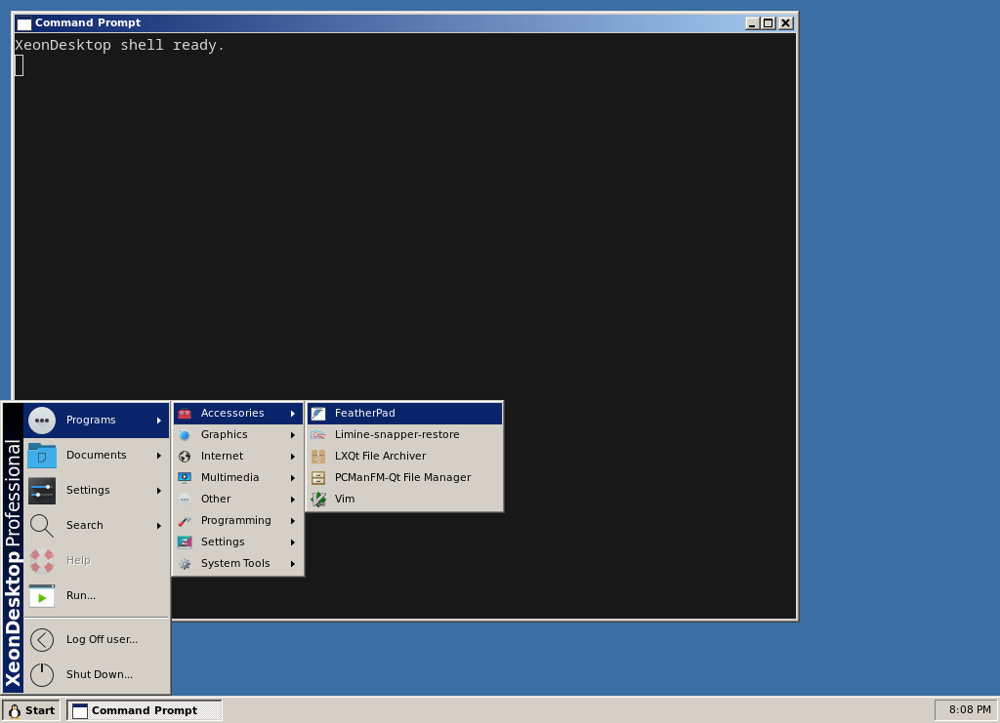
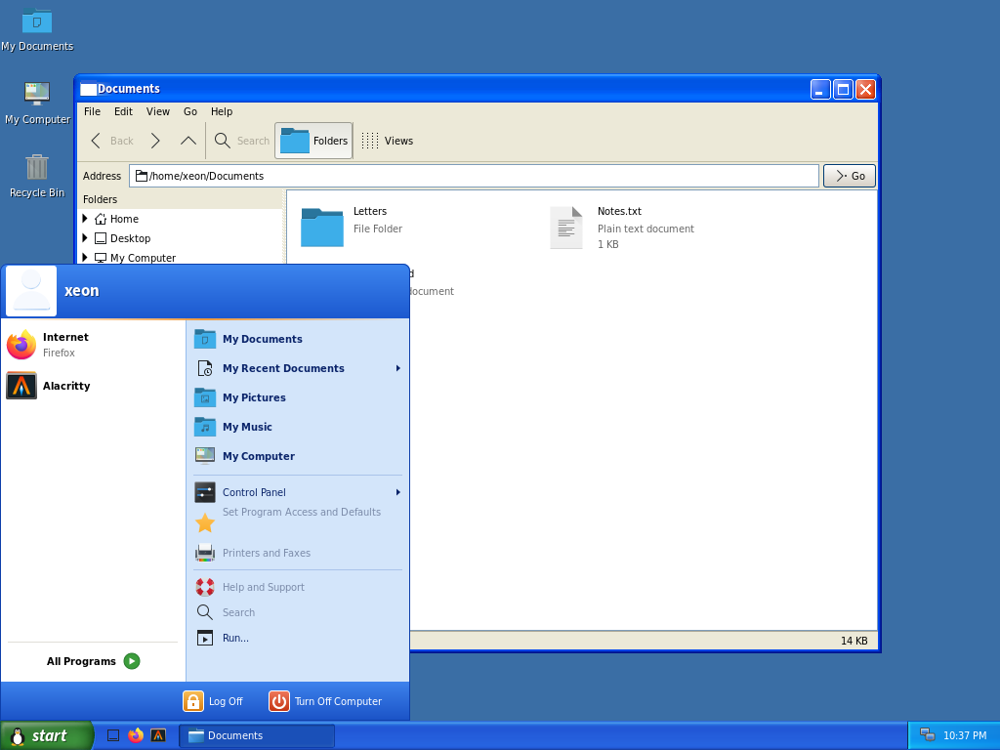
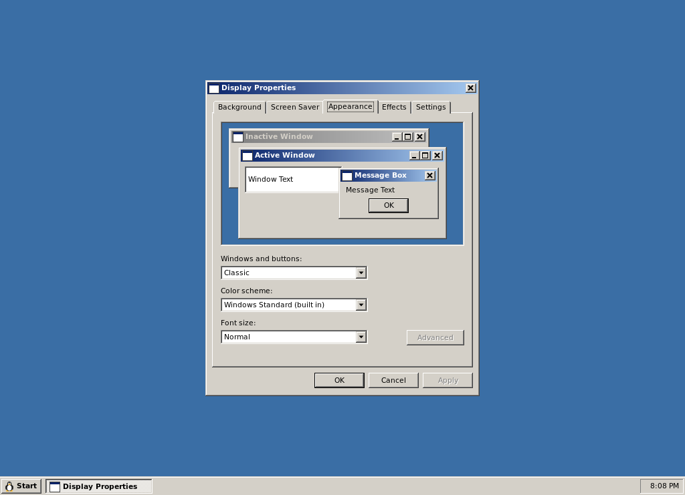

# XeonDesktop

A Windows 2000/XP-style desktop environment for Linux (Wayland), written in
strict C23. See [docs/ARCHITECTURE.md](docs/ARCHITECTURE.md) for the design.

| Classic (Windows 2000) | Luna (XP) |
|---|---|
|  |  |
| **Display Properties** | **Shut Down** |
|  |  |

All artwork is drawn by the theme engine; no Microsoft assets are used.
The Start button logo is Tux, the Linux mascot originally drawn by Larry
Ewing (lewing@isc.tamu.edu) with The GIMP; ours is a simplified procedural
rendition. Screenshots are from a nested development session.

## Build

Dependencies: meson, ninja, cairo, pango; wlroots 0.20 (compositor, later
milestone).

    meson setup build          # debug build with ASan/UBSan
    ninja -C build
    meson test -C build

Release build: `meson setup build-release -Dbuildtype=release -Db_sanitize=none`.
Static analysis: `meson setup build-analyze -Danalyzer=true`.

## Run the compositor

Nested in an existing X11 or Wayland session (opens a window), or from a TTY:

    ./build/xd-compositor --style classic|luna|whistler [--scheme FILE] [--scale 1.5] -s alacritty

The compositor starts `xd-shell` (the taskbar) itself, passing on the style
and scheme, and restarts it if it crashes. Use `--no-shell` to skip it.
Clicking a task button activates that window; clicking the active window's
button minimizes it.

| Keys                | Action                                          |
|---------------------|-------------------------------------------------|
| Alt+Tab / Alt+Shift+Tab | Switch windows (release Alt to choose)      |
| Alt+F4              | Close window                                    |
| Win+Up / Win+Down   | Maximize / restore or minimize                  |
| Ctrl+Alt+T          | Open terminal (`--terminal CMD`)                |
| Ctrl+Alt+Backspace  | Quit the compositor                             |

Mouse: drag the caption to move, drag edges/corners to resize, double-click
the caption to maximize, double-click the window icon to close.

### Start menu

The Windows 2000 Start menu is built from installed `.desktop` files, filed
into Programs folders (Accessories, Games, Graphics, Internet, ...) by their
categories. Run..., Log Off and Shut Down... open `xd-run` and `xd-shutdown`; items that
need parts of the desktop not written yet (Control Panel, Search, Help) are
shown greyed out.

### Quick Launch

The icons next to Start are the shortcuts in
`~/.local/share/xeondesktop/quicklaunch/`: `.desktop` files or symlinks to
installed ones, ordered by file name (number them to reorder). The first run
creates Show Desktop, your browser and your terminal; after that the folder is
yours, and changes appear immediately. Show Desktop minimizes every window,
and clicking it again restores them. Hide the toolbar with `QuickLaunch=false`
under `[Taskbar]` in `desktop.ini`.

### Display Properties

`xd-desk` (Start > Settings > Control Panel > Display) has Windows 2000's
tabs. Appearance (style, colour scheme, font size, with a live preview) and
Background (wallpaper and how it's placed) work; Effects has font
smoothing; Screen Saver and Settings show what's there but can't change it
yet. Apply writes `~/.config/xeondesktop/desktop.ini`, which the compositor
and shell watch, so changes show up immediately everywhere. Command-line
`--style`/`--scheme` override the file until it next changes.

### Run and Shut Down

- `xd-run`: opens programs, folders, documents and URLs; remembers the last
  26 commands (`~/.local/state/xeondesktop/run-history`).
- `xd-shutdown`: Log off, Shut down, Restart, Stand by and Hibernate (the
  last two only if the kernel supports them), through `systemctl`.
  `xd-shutdown --logoff` asks "Are you sure you want to log off?".
- **In a nested session** (compositor started inside another desktop), and
  with `--dry-run`, power actions are only printed, never run. Log off ends
  the nested session.

| Variable              | Effect                                                   |
|-----------------------|----------------------------------------------------------|
| `XD_ICON_THEME`       | Icon theme to use (default `breeze`, falls back to Adwaita, hicolor) |
| `TERMINAL`            | Terminal for `Terminal=true` apps (default `alacritty`)  |
| `XD_SHELL_OPEN_MENU`  | Testing aid: open the Start menu along a path at startup, e.g. `Programs/Accessories` |

## Automated UI testing

`xd-inject` moves the pointer, clicks and types inside a session started
with `--allow-virtual-input`, using the virtual pointer and keyboard
protocols. Only that nested session is affected; your real mouse and
keyboard aren't touched. Never use `--allow-virtual-input` for a real
session: it lets any program type and click as you.

    ./build/xd-compositor --allow-virtual-input -s 'sleep 2; ./build/xd-inject \
        move 25 727 click sleep 400 move 85 610 click sleep 800 \
        type "alacritty" key Return'

Steps: `move X Y`, `click [left|right|middle]`, `down`/`up`, `wheel N`,
`type TEXT`, `key COMBO` (e.g. `ctrl+alt+t`, `alt+F4`), `sleep MS`.

## Preview themes

    ./build/xd-themeview --style classic|luna|whistler [--scheme data/schemes/X.ini] [--scale 1.5] --out preview.png
