# XeonDesktop

A Windows 2000, XP and 7-style desktop environment for Linux (Wayland),
written in strict C23. See [docs/ARCHITECTURE.md](docs/ARCHITECTURE.md) for
the design.

| Classic (Windows 2000) | Luna (XP) |
|---|---|
| 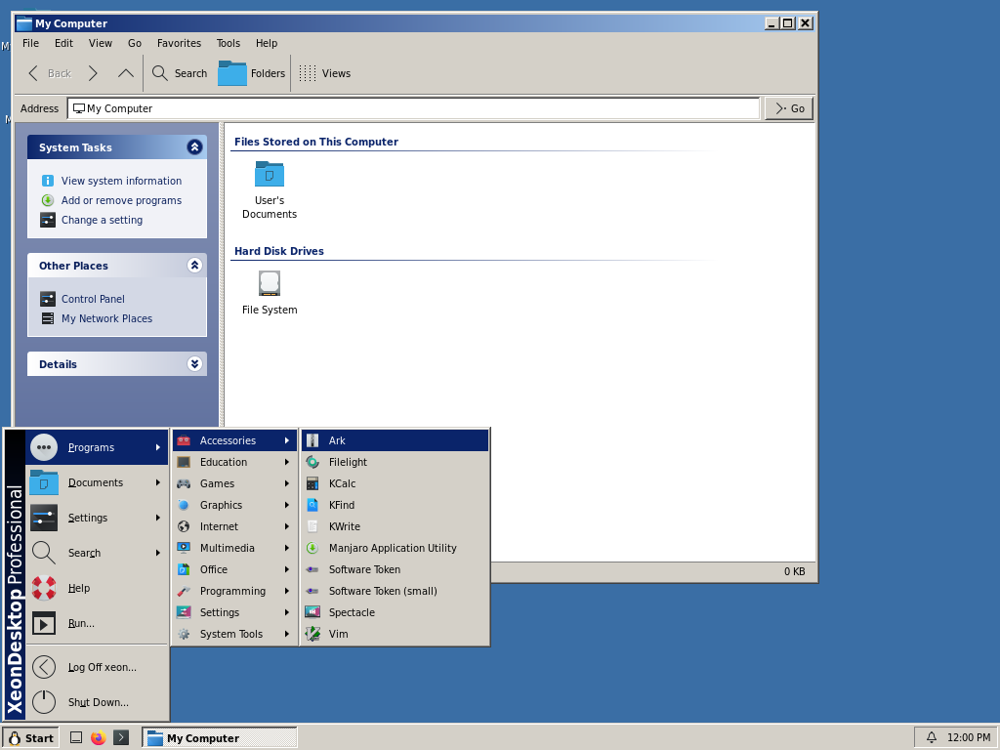 | 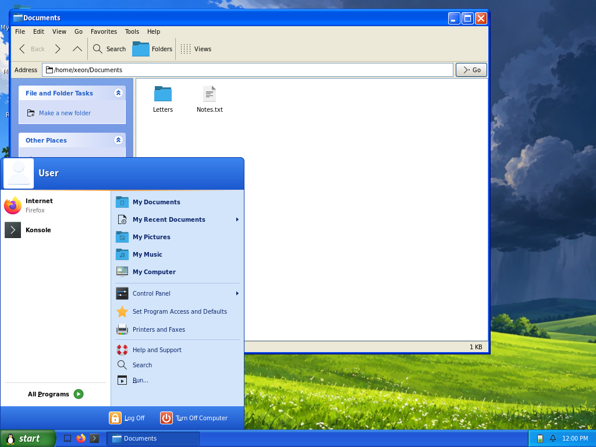 |
| **Luna, Olive Green** | **Luna, Silver** |
| 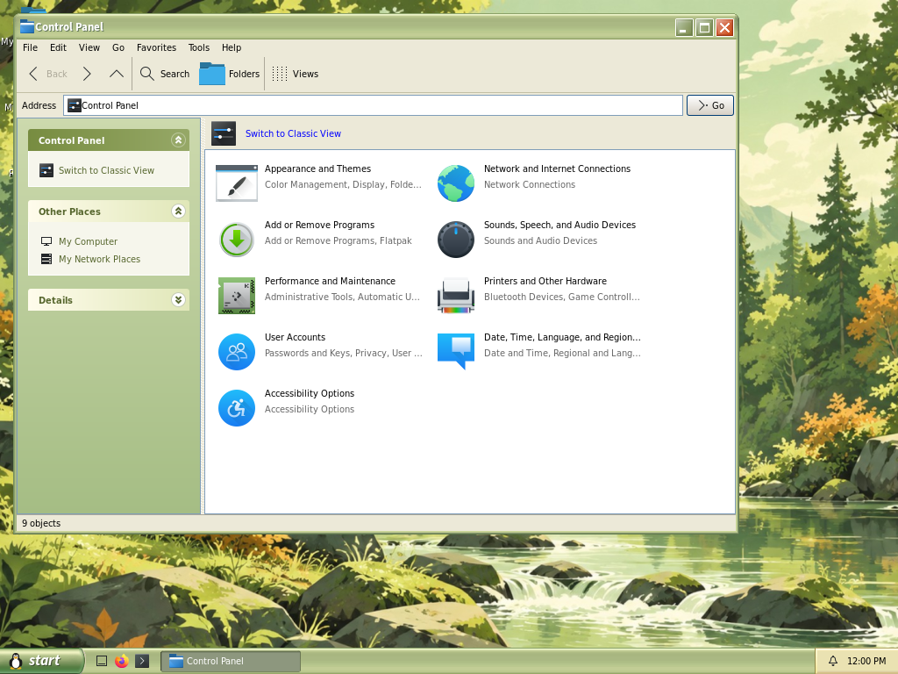 | 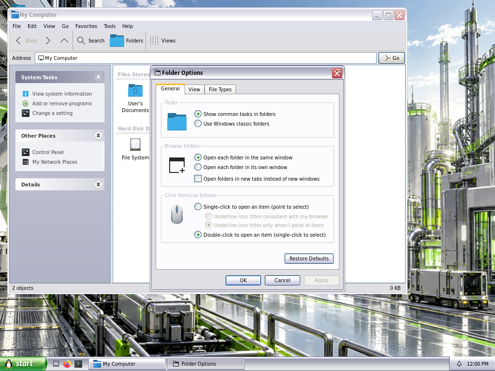 |
| **Luna, Dark** | **Watercolor (Whistler)** |
| 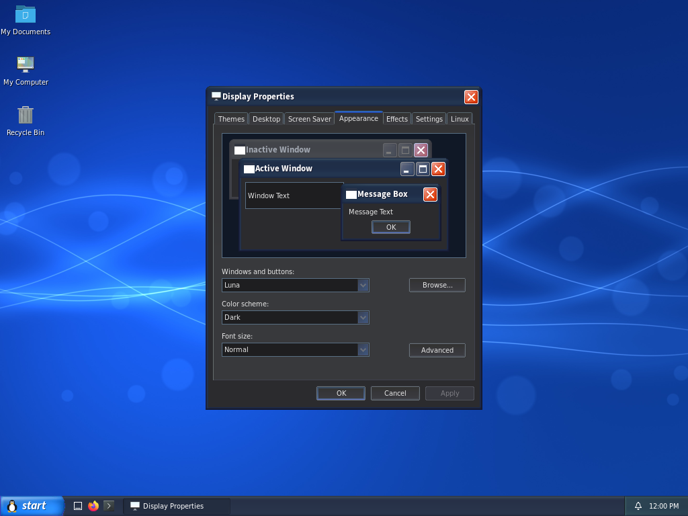 | 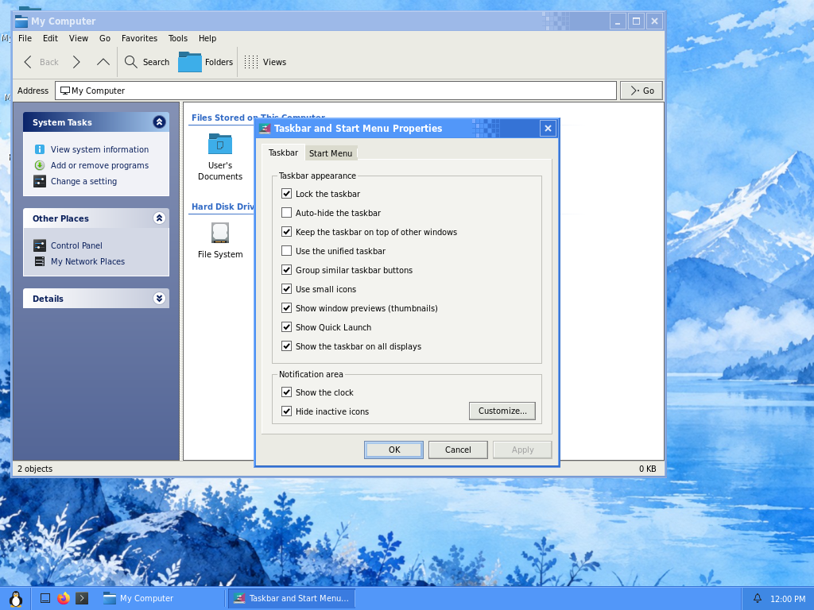 |
| **Aero (Windows 7)** | **Aero Snap** |
| 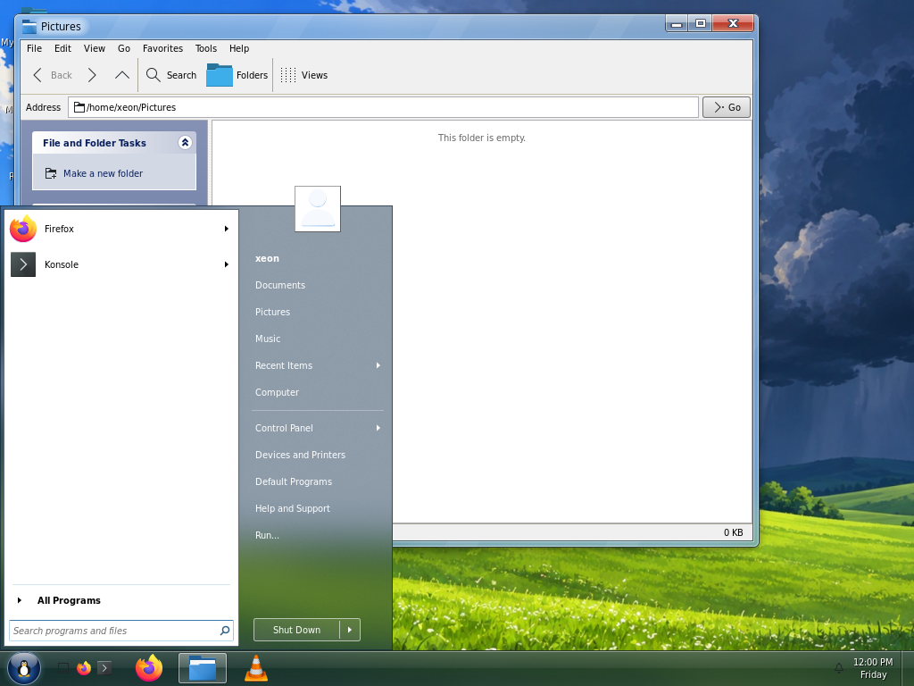 | 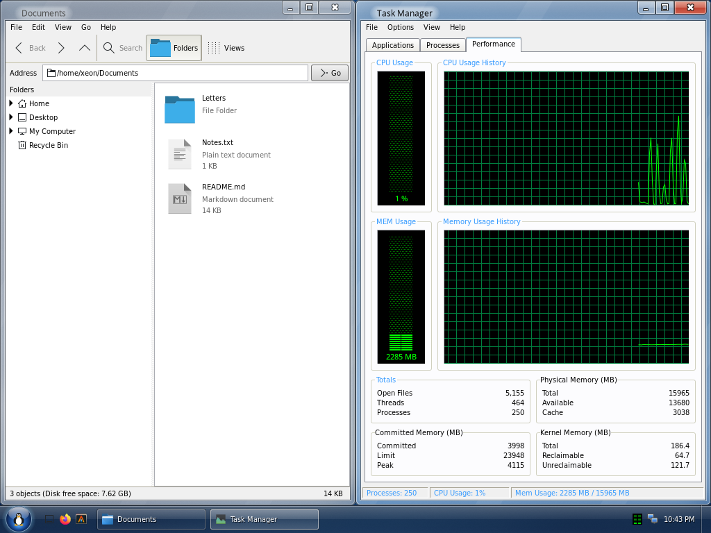 |
| **Taskbar thumbnails** | **Alt+Tab** |
| 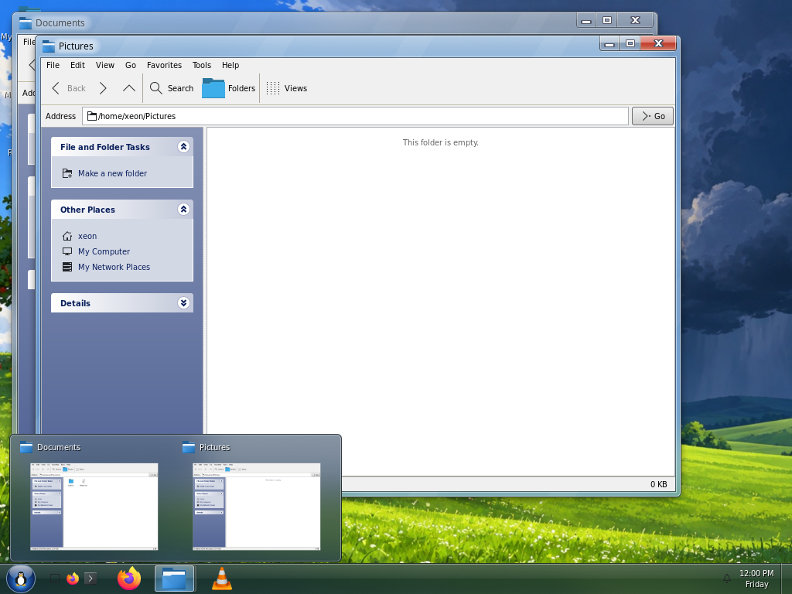 | 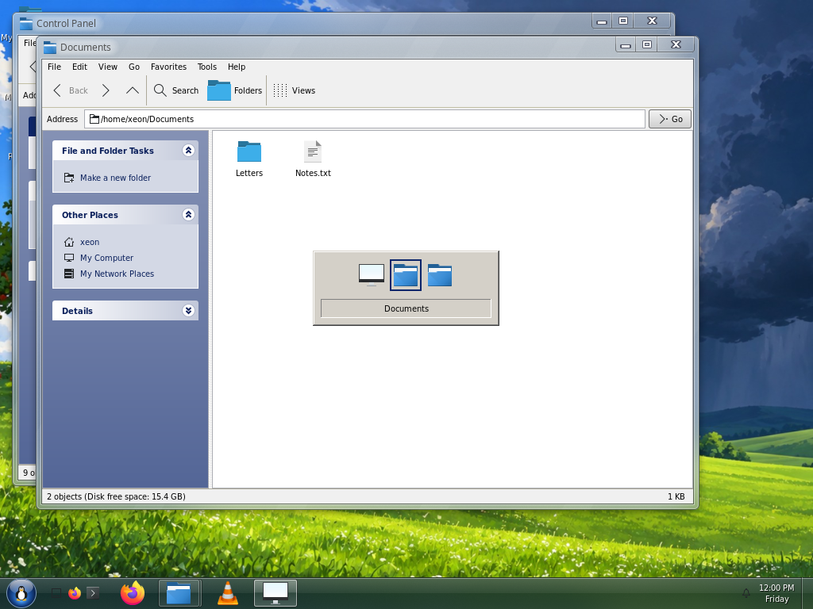 |
| **Date and Time** | **Minefield** |
| 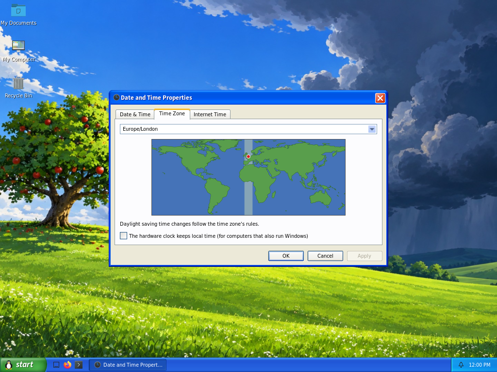 | 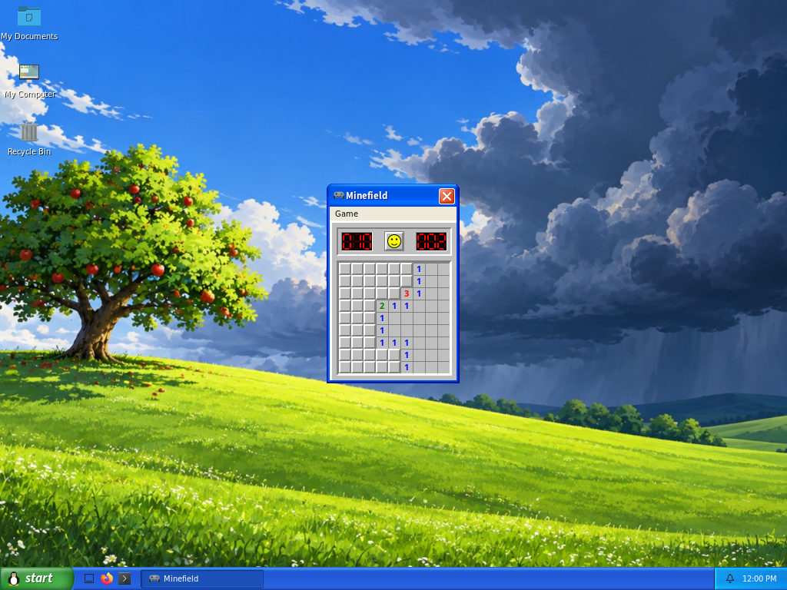 |
| **Shut Down** | **Windows Security (Ctrl+Alt+Delete)** |
| 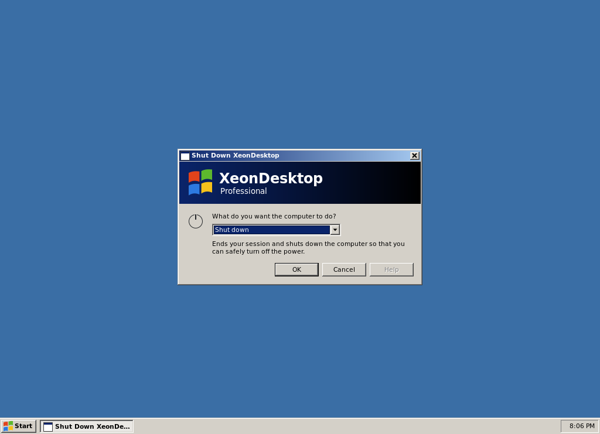 | 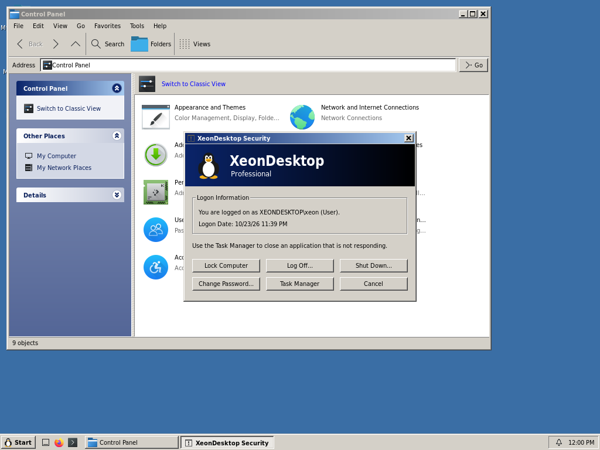 |

All artwork is drawn by the theme engine; no Microsoft assets are used.
The Time Zone map draws Natural Earth's land outlines (public domain,
naturalearthdata.com).
The Start button logo is Tux, the Linux mascot originally drawn by Larry
Ewing (lewing@isc.tamu.edu) with The GIMP; ours is a simplified procedural
rendition. Screenshots are from headless sessions at 1024x768, with a
stand-in user and our own wallpapers; the Aero ones use the GPU build
(blurred glass). `tools/screenshots.sh` takes them again (the UI tests'
showcase scenarios).

## Build

Dependencies: meson, ninja, wlroots 0.20 (where the system has none, a
pinned copy is built from `subprojects/` and linked in statically, needing
libseat, libdisplay-info, hwdata and libgbm; SceneFX, for Aero's blurred
glass, always is), wayland and
wayland-protocols, xkbcommon and xkbregistry, xcb and xcb-icccm, libdrm,
libinput, cairo, pango, fontconfig, GLib/GIO, GTK 3, gtk-layer-shell
(the Snipping Tool), GStreamer (screen recording), gdk-pixbuf, json-glib,
procps-ng's libproc2 (Task Manager), PAM and libxcrypt (Lock Computer, User
Accounts), libudev and libevdev (Device Manager, Game Controllers),
polkit's agent library, libpulse and libcanberra (volume, sounds), libnm
(Network Connections), PackageKit and Flatpak (Add or Remove Programs),
libcups, SANE and libgphoto2 (printers, scanners, cameras), libsystemd,
libxcursor (pointer previews), libarchive (Send To > Compressed Folder)
NUT's libupsclient (Power Options' UPS tab) and xdg-desktop-portal's
interface files (the Open and Save As dialogs).
At run time, Xwayland (`xorg-xwayland`) runs X11 applications; without it
only Wayland ones work. xdg-desktop-portal gives Flatpaks, GTK 4 programs,
Firefox and Chromium our Open and Save As dialogs
(xdg-desktop-portal-xeondesktop); GTK 3 programs that build GTK's own
dialog keep it, themed. With NVIDIA's proprietary driver, the compositor
needs `egl-gbm` (`libnvidia-egl-gbm1` on Debian) and `nvidia_drm.modeset=1`;
without them it draws in software, with no Aero glass or Desktop Effects,
and says which is missing in its log.
Fonts: Windows' fonts are replaced by the closest freely packaged ones,
DejaVu Sans Condensed for Tahoma (its width and shapes), Source Sans 3 for
Trebuchet MS (Luna captions) and Roboto Condensed for Franklin Gothic (XP's
Start button): `ttf-dejavu`, `adobe-source-sans-fonts` and `ttf-roboto` on
Arch, `fonts-dejavu-extra`, `fonts-adobe-sourcesans3` and
`fonts-roboto-unhinted` on Debian. The real fonts are used if installed.

    meson setup build          # debug build with ASan/UBSan
    ninja -C build
    meson test -C build
    meson test -C build --setup ui --suite ui   # UI tests, headless (see below)

Release build: `meson setup build-release -Dbuildtype=release -Db_sanitize=none`.
Static analysis: `meson setup build-analyze -Danalyzer=true`.

## Packages

GitHub Actions (`.github/workflows/packages.yml`) builds a `.deb` for Debian
testing and unstable and for Ubuntu 26.04 LTS (whose wlroots is 0.19, so its
package has our wlroots 0.20 built in), each for amd64 and arm64, and an
x86-64 package for Arch Linux, CachyOS and Manjaro (stable, built against
its own libraries) on every push; they're under the run's Artifacts, and
tagging `vX.Y.Z` attaches them to a release. To build them
locally with podman (or docker):

    podman run --rm -v "$PWD":/src -w /src debian:testing packaging/build-deb.sh
    podman run --rm -v "$PWD":/src -w /src ubuntu:26.04 packaging/build-deb.sh
    podman run --rm -v "$PWD":/src -w /src cachyos/cachyos packaging/build-arch.sh
    podman run --rm -v "$PWD":/src -w /src manjarolinux/base packaging/build-arch.sh

The packages land in `dist/`. Installing one adds **XeonDesktop** to the
display manager's session list. `xeondesktop-session` reads
`~/.config/environment.d` and starts the compositor, which gives systemd's
user manager the session's display and starts `xeondesktop-session.target`
(binding `graphical-session.target`): autostart entries
(`/etc/xdg/autostart`, `~/.config/autostart`) and "When I log on" scheduled
tasks run then, and stop when you log off. In a VirtualBox guest, the guest
additions' shared clipboard is started as a Wayland client so copy and paste
work both ways, and drag and drop works both ways too: VirtualBox's own
guest client only does it under X11, so `xd-vboxdnd` (started by the
compositor when `/dev/vboxuser` is there) talks to the host's drag and drop
service itself. Files dragged from the host onto the VM's window are
received into `$TMPDIR/VirtualBox Dropped Files` and dropped on what's under
the pointer; files dragged out of the VM's window are sent to the host.
The VM's Devices > Drag and Drop setting chooses which ways.

## Run the compositor

Nested in an existing X11 or Wayland session (opens a window), or from a TTY:

    ./build/xd-compositor --style classic|luna|whistler [--scheme FILE] [--scale 1.5] -s alacritty

The compositor starts `xd-shell` (the taskbar) itself, passing on the style
and scheme, and restarts it if it crashes. Use `--no-shell` to skip it.
Clicking a task button activates that window; clicking the active window's
button minimizes it. The style (including Aero) normally comes from
Display Properties. On a GPU it hands over to `xd-compositor-fx` for Aero's
blur and shadows; on a virtual machine's GPU it renders in software
instead, which is faster there.

| Keys                | Action                                          |
|---------------------|-------------------------------------------------|
| Win, Ctrl+Esc       | Start menu                                      |
| Alt+Tab / Alt+Shift+Tab | Switch windows (release Alt to choose)      |
| Alt+F4              | Close window                                    |
| Alt+Space           | Window menu                                     |
| Win+Up / Win+Down   | Maximize / restore or minimize                  |
| Win+Left / Win+Right | Aero Snap to half the screen, then the next monitor (Aero) |
| Win+Shift+Up        | As tall as the screen (Aero)                    |
| Win+Shift+Left/Right | Move to the next monitor (Aero)                |
| Win+Space           | Aero Peek at the desktop (Aero)                 |
| Ctrl+Alt+T          | Open terminal (`--terminal CMD`)                |
| Ctrl+Alt+Delete     | Windows Security (Classic style) or Task Manager (XP styles) |
| Ctrl+Shift+Esc      | Task Manager                                    |
| Win+L               | Lock Computer                                   |
| Print Screen        | Copy the screen to the clipboard                |
| Alt+Print Screen    | Copy the active window to the clipboard         |
| Win+Shift+S         | Snipping Tool: a new snip                       |
| Win+Shift+R         | Record an area of the screen (again: stop)      |
| Win+Alt+R           | Record the active window (again: stop)          |
| Ctrl+Alt+Backspace  | Quit the compositor                             |
| Ctrl+Alt+F1..F12    | Switch virtual terminal                         |
| Ctrl+Alt (alone)    | Release a mouse or keyboard a program captured  |

Mouse: drag the caption to move, drag edges/corners to resize, double-click
the caption to maximize, double-click the window icon to close.

Programs that capture the mouse and keyboard (games, Blender, virtual
machines, remote desktops) can lock or confine the pointer and take the
shortcuts above while their window is in front; Ctrl+Alt+Delete, Win+L,
Ctrl+Alt+F1..F12 and Ctrl+Alt+Backspace always stay ours, and Ctrl+Alt on
its own gives the mouse and keyboard back.

Touchscreens and drawing tablets work in programs that read them, and as
the mouse everywhere else (our window frames, the taskbar, older programs).
Touchpads tap to click (two fingers tapped right-click, three
middle-click) and scroll with two fingers, both changeable on Mouse
Properties' Touchpad tab with reverse scrolling, the right-click corner or
two-finger click, turning it off while typing or with a mouse plugged in,
and its own speed. Pinches and two-finger swipes go to the program under
the pointer; three-finger swipes are the desktop's: down shows the
desktop, up brings the windows back, sideways switches windows.

Alt+Tab shows Windows 2000/XP's box of the open windows (Windows 7's, with
a Vista or 7 theme package).

Programs' progress, unread counts and urgency (Unity's LauncherEntry:
Firefox, Thunderbird, Chromium, KDE programs) show on Windows 7's taskbar
buttons.

For games: explicit sync (linux-drm-syncobj, on any GPU whose driver has
timelines), variable refresh rate for full-screen windows (Display
Properties > Settings > Advanced > Monitor), tearing for games with vsync
off, and full-screen windows scanned out directly.

### Start menu

The Windows 2000 Start menu is built from installed `.desktop` files, filed
into Programs folders (Accessories, Games, Graphics, Internet, ...) by their
categories. Run..., Log Off and Shut Down... open `xd-run` and `xd-shutdown`;
Search opens the file manager's Search (`xd-files --search`),
Help opens `xd-help`, and Settings holds Control Panel, Network Connections,
Printers and Taskbar & Start Menu. The menus work from the keyboard: arrows
within and across columns, Tab, Enter and Esc, and typing a letter picks
the item it starts with (or its underlined letter: Win, U, U turns the
computer off). In the XP menu, right-click a program in All Programs to pin
it; newly installed programs are highlighted until first opened;
Customize Start Menu picks large or small icons and how many programs.

### Start menu styles

Start > Settings > Taskbar & Start Menu picks the layout:

- **Classic (Windows 2000)**: cascading menus with the side banner.
- **Windows XP**: your picture and full name across the top; pinned programs
  (the browser and mail client labelled Internet and E-mail, as in XP) and
  your most used programs on the left over **All Programs**, which cascades
  into the Programs menus; My Documents, My Recent Documents, My Pictures,
  My Music, My Computer, Control Panel, Printers and Faxes, Help and
  Support, Search and Run on the right; Set Program Access and Defaults
  (`xd-defaults`) under All Programs; Log Off and Turn Off Computer along
  the bottom. Luna, Watercolor (Whistler) and Classic colours.
- **Windows 7**: pinned programs (`~/.config/xeondesktop/start-pinned`, one
  desktop file id per line; browser and terminal by default) and your most
  used programs on the left, **All Programs** opening in place, and a search
  box that finds programs and Control Panel applets. A ▸ beside a program
  opens its jump list (recent files and its tasks). On the right: your
  picture (`~/.face`), user folders, Recent Items, Computer, Control Panel,
  Devices and Printers, Default Programs, Help and Support, Run and a Shut
  Down button whose ▸ offers Switch user, Log off, Restart, Sleep and
  Hibernate. In Luna the right column is
  the dark panel (opaque until the compositor can blur behind it).

### Windows 7 taskbar

In the Aero style the taskbar is Windows 7's, and in any other style it can
be, with Taskbar Properties' "Use the unified taskbar" (drawn with that
style's own task buttons): pinned and running programs
share one row of icon buttons (`~/.config/xeondesktop/taskbar-pinned`, one
desktop file id per line). A running program's button is framed, with
stacked edges for more windows; click to start it, switch to it or cycle its
windows, middle-click for another, drag to reorder. Right-click for its jump
list: recent files, its tasks, pin or unpin, close. Taskbar Properties'
"Taskbar buttons" also offers "Combine when taskbar is full" (combining
the least recently used programs first, only as needed) and "Never
combine", with labels. Hovering a running program's button shows live
thumbnails of its windows; hovering a thumbnail peeks at that window. Jump
lists keep pinned files above Recent; drop a file on a program's button to
pin it there, or a launcher on the bar to pin the program.

"Use small icons", in every style and with either taskbar, chooses between
Windows 7's large icons on a 40px taskbar and small ones on XP's 30px; it
follows the taskbar until it's chosen (large on the unified one).

Clicking the unified taskbar's clock opens Windows 7's flyout: the date, a
month calendar and an analog clock, with a link to Date and Time (XP's
taskbar keeps the double-click straight to Date and Time).

Window previews (live thumbnails) show on both taskbars: hovering a
window's or a group's task button in XP's shows them too, drawn as the
style's tooltips outside Aero. "Show window previews (thumbnails)" turns
them off for XP's plain tooltips.

### Taskbar menus

Right-clicking the taskbar opens Windows XP's taskbar menu: Toolbars ▸ Quick
Launch and Desktop Manager (four virtual desktops and their pager, as XP
PowerToys' Virtual Desktop Manager; Desktop Effects' General Options set
other layouts), Cascade Windows, Tile Windows Horizontally/Vertically (with Undo),
Show the Desktop, Task Manager, Lock the Taskbar and Properties. Arranging
windows goes through `xd-window-arranger-v1`, a private protocol the
compositor offers only to the shell it started. Right-clicking a task
button opens the window menu: Restore, Move, Size (with the arrow keys, as
in Windows), Minimize, Maximize and Close.

### Notification area

The tray shows StatusNotifierItem icons (the protocol KDE, Ayatana and most
current Linux programs use), with their menus, next to the built-in clock,
volume, network, Bluetooth and battery icons; inactive icons fold behind a
chevron as in XP (Customize... in Taskbar Properties). Old XEmbed tray icons
don't exist on Wayland.

### Notifications

XeonDesktop is the session's notification server
(`org.freedesktop.Notifications`). Programs' notifications show as XP's
balloons from a bell icon in the notification area, one at a time: the icon
or picture, the title in bold, a few lines of text, and the program's
actions as links. A click on the balloon does what the program offers for
it (or opens the program); the close box puts it away. A balloon stays while
the pointer is over it, and urgent ones stay until they're closed.

Notifications that went unclicked, or came while a full-screen window was in
front or Do Not Disturb was on, wait in the history: click the bell to see
them, newest first, with Clear all and Do Not Disturb at the bottom (also on
the bell's right-click menu, and `DoNotDisturb=` under `[Taskbar]` in
`desktop.ini`). The history is kept across logons. Another notification
server (mako, dunst) running in the session is replaced.

### Quick Launch

The icons next to Start are the shortcuts in
`~/.local/share/xeondesktop/quicklaunch/`: `.desktop` files or symlinks to
installed ones, ordered by file name (number them to reorder). The first run
creates Show Desktop, your browser and your terminal; after that the folder is
yours, and changes appear immediately. Show Desktop minimizes every window,
and clicking it again restores them. Hide the toolbar with `QuickLaunch=false`
under `[Taskbar]` in `desktop.ini`.

### Display Properties

`xd-desk` (Start > Settings > Control Panel > Display) has Windows XP's
tabs, and one for what only Linux has:

- Themes (first, as in XP): a theme sets the visual style, wallpaper, sound
  scheme and mouse pointers together: Windows XP, Windows Classic, and
  theme packages that bring them, with a sample, Save As..., Delete and
  Browse... for Windows `.theme` files (pointers need `win2xcur`).
- Desktop: the wallpaper (from the usual folders or Browse...) and how
  it's placed. Five come with XeonDesktop (in `/usr/share/wallpapers/xeondesktop`):
  Watercolor Blue for Watercolor, and Storm Hill, Olive Forest, Silver
  Factory and Energy for the XP colours. Energy is painted from noise by
  `tools/xd-wallpapers`; the others are AI-generated pictures made for the
  project. None come from Windows.
- Screen Saver: eleven savers, each with its Settings (saved to
  `[ScreenSaver.*]`), a live preview, Wait, Password protected, and when to
  turn the monitors off. The 3D ones (Flower Box, Maze, Pipes, Text) are
  drawn by a small software renderer with depth and per-pixel lighting;
  3D Maze walks a random maze in the look of 90s first-person shooters, its
  textures generated in code. Digital Rain, a Linux addition, is the film's
  falling green glyphs (mirrored katakana and digits, or digits, binary or
  letters, in green, amber, blue, white, rainbow or a colour of your own).
- Desktop: Customize Desktop picks which of My Documents, My Computer, My
  Network Places and the web browser show on the desktop, and their icons.
- Appearance: style, colour scheme and font size, with a live preview: all
  22 of XP's classic colour schemes, and for the XP style Default (blue),
  Olive Green, Silver and Energy Blue (Royale), each measured from a
  screenshot of the real thing, and Dark, our own: Blue's frames, taskbar
  and controls redrawn in charcoal with its blue kept for selections and
  highlights, dark window contents (the GTK and Qt themes too), and Breeze
  Dark's icons when no icon theme is chosen. Advanced opens Windows XP's Advanced
  Appearance: click a part of the preview or pick an item, and set its
  size, colours and font (saved as `[CustomScheme]` over the scheme). In
  Aero, Advanced opens Window Color and Appearance: Windows 7's 16 glass
  colours, transparency, intensity and a colour mixer, with a link to
  Advanced Appearance. Windows and buttons also lists the installed theme
  packages ([docs/THEMES.md](docs/THEMES.md)), with their colours in Color
  scheme and their sizes in Font size, as XP lists a visual style's; the
  preview draws with the one chosen before Apply. Browse... installs a
  `.xdtheme`, or converts a Windows visual style (a `.msstyles`, or a
  `.theme` beside one) with `xd-theme-import` (python-pefile) in the
  background into `~/.local/share/xeondesktop/themes`, and chooses it.
- Effects: XP's Effects: fade or scroll menus and tooltips, large icons,
  "Show window contents while dragging" (off, a window is dragged as an
  outline) and hiding the underlined letters until Alt is pressed; and
  Font smoothing as FreeType does it, under GNOME's names: Antialiasing
  (None, Standard (grayscale), Subpixel (for LCD screens)), Subpixel order
  and Hinting. Other programs get them too: a real session writes them to
  `org.gnome.desktop.interface` and GTK's `settings.ini`. Theme images:
  how a theme package's pictures are scaled for high DPI (Automatic, the
  package's own choice; Nearest, Integer, Smooth, or the pixel-art scalers
  Scale2x, Scale3x, Scale4x, 2xSaI, Super2xSaI and SuperEagle), and exact
  whole-number scaling at 200% and 300%.
- Settings: as below, and Identify, which shows each monitor's number on
  it.
- Linux: the icon theme and the GTK theme ("Program style"), our
  generated one matching the style by default, and Qt's widget style. A
  chosen GTK theme is also written where other desktops'
  settings tools put it (`~/.config/gtk-3.0` and `gtk-4.0` `settings.ini`,
  `org.gnome.desktop.interface`), so GTK programs however started agree.
- Settings: drag the monitors into place, and set each one's resolution,
  refresh rate, scale and orientation, or turn it off. As in Windows, new
  display settings revert after 15 seconds unless you keep them. They're
  remembered per monitor in `~/.config/xeondesktop/monitors.ini`.

Apply writes `~/.config/xeondesktop/desktop.ini`, which the compositor and
shell watch, so changes show up immediately everywhere. Command-line
`--style`/`--scheme` override the file until it next changes.

### Lock Computer and screen savers

Win+L (or `xd-lock`) locks the computer the Windows 2000 way: "Computer
Locked", then Ctrl+Alt+Del for the Unlock Computer dialog, which checks
your password with PAM. It uses the `xeondesktop` PAM service that
`meson install` puts in `/etc/pam.d` (falling back to `login`). If the
locker crashes the screen stays locked and the compositor starts it again.

The shell starts the chosen screen saver (`xd-lock --saver`) after the Wait
time; video players hold it off. With Password protected, it drops to the
locked screen when you come back.

### Control Panel

Control Panel is a folder in the file manager (`control:`, or
`xd-control`), with XP's Category View and Classic View. Each applet is
its own program, found by its `.desktop` file
(`Categories=...;X-XeonDesktop-ControlPanel;` and
`X-XeonDesktop-ControlPanel-Category=appearance|network|programs|sound|performance|hardware|accounts|datetime|accessibility`),
and `xd-control NAME` opens one (`xd-control desk`, as Windows'
`control desk.cpl`). The applets:

| Applet | Program | What it changes |
|---|---|---|
| Accessibility Options | `xd-access` | StickyKeys, FilterKeys (SlowKeys, BounceKeys), ToggleKeys, MouseKeys and High Contrast, with XP's shortcuts, done by the compositor |
| Add or Remove Programs | `xd-appwiz` | installed programs (size, last used, where each came from: the package manager's repository, Flatpak, AppImage), remove and install through PackageKit and Flatpak |
| Administrative Tools | `xd-admintools` | Services (systemd), Event Viewer (the journal), Disk Management (UDisks2: partitions, quick or full formatting, resizing, startup mount points in /etc/fstab, encrypted (LUKS) volumes), Device Manager, System Configuration Utility (`msconfig`: startup programs and your systemd user services) |
| Automatic Updates | `xd-wuaucpl` | distribution (PackageKit) and Flatpak updates in one list, firmware (fwupd) and its Host Security ID; a scheduled check with XP's tray balloon, never installing without your click |
| Bluetooth Devices | `xd-bluetooth` | pairing (XP SP2's wizard and passkeys), device properties, the adapter's options, through BlueZ |
| Color Management | `xd-color` | colord's devices and ICC profiles; a monitor's calibration applied to its gamma ramp |
| Date and Time | `xd-timedate` | the clock and time zone, through timedated; Internet Time's servers and Update Now on timesyncd; the hardware clock in local time, for dual boot |
| Desktop Effects | `xd-effects` | Compiz Fusion-style effects, laid out as CompizConfig Settings Manager, all off by default: Scale, Animations, Window Opacity, Ring and Shift switchers, Enhanced Zoom, Annotate, Show Mouse; virtual desktops with a taskbar pager, Desktop Wall, Cube and Expo; Wobbly Windows, Magic Lamp, Burn, Explode, Water and the Animations Add-On (Airplane, Beam Up, Domino, Razr, Fold, Glide 3, Leaf Spread, Skewer) (the OpenGL ones need the SceneFX compositor) |
| Display | `xd-desk` | style, colours, wallpaper, screen saver, monitors, night light |
| Flatpak | `xd-flatpak` | Flatpak apps' permissions (sockets, devices, files, environment, D-Bus names) as your own overrides, and remotes |
| Folder Options | `xd-folders` | the file manager's options, file types (`mimeapps.list`; new types in your shared-mime-info database) |
| Fonts | `xd-fonts` | lists, previews, prints, installs and removes your fonts (fontconfig) |
| Game Controllers | `xd-joy` | joysticks and gamepads from udev, with a live test page (read only) |
| Keyboard | `xd-keyboard` | key repeat, cursor blink, layouts and XKB options; Text Services: the input method (Fcitx 5 or IBus), the Compose key |
| Mouse | `xd-mouse` | buttons, ClickLock, double-click speed, pointer theme and size, speed, wheel, the touchpad (tapping, scrolling, three-finger swipes) |
| Network Connections | `xd-netconn` | connections, status, TCP/IP settings, wireless networks, through NetworkManager |
| Passwords and Keys | `xd-keys` | stored passwords (the Secret Service), SSH keys and ssh-agent, PGP keys (GnuPG) |
| Power Options | `xd-power` | power schemes (plugged in and on batteries), monitor, standby and hibernate timers, battery alarms, the power meter, the battery icon, locking on resume, and what the lid and the power and sleep buttons do, per user |
| Printers and Faxes | `xd-printers` | CUPS printers, queues, preferences, test pages, the Add Printer wizard, ports and sharing |
| Privacy | `xd-privacy` | recent documents, emptying old Recycle Bin and temporary files, location services, programs' portal permissions |
| Regional and Language Options | `xd-intl` | your formats, customised (numbers, currency, time, date); the system locale and keyboard through localed |
| Scanners and Cameras | `xd-scanners` | SANE scanners and gphoto2 cameras, the Scanner and Camera Wizard |
| Scheduled Tasks | `xd-schedtasks` | XP's wizard over systemd user timers: run programs daily, weekly, at logon... |
| Sounds and Audio Devices | `xd-sound` | volume, default devices, the sound scheme: windows, menus, message boxes, devices, battery, Recycle Bin, logon and logoff (libcanberra) |
| System | `xd-sysdm` | see below |
| Taskbar and Start Menu | `xd-taskbar` | the taskbar and Start menu options |
| User Accounts | `xd-users` | pictures, names, passwords and accounts, through AccountsService; automatic logon (`xd-control userpasswords2`, for display managers that follow AccountsService) |

Settings go to `desktop.ini` (`[Mouse]`, `[Accessibility]`, `[Power]`,
`[Sound]`, `[Folders]`, ...), which the compositor, the shell and our GTK
programs re-read when it changes; system settings go through the
services' polkit checks, never as root.

### System Properties

`xd-sysdm` (Control Panel > System) is Windows 2000's System Properties
with Linux inside:

- General: the distribution, kernel, owner, CPU, firmware and memory.
- Network Identification: the computer's name and description, through
  systemd-hostnamed.
- Hardware:
  - Device Manager, built from udev, with Driver and Details tabs per
    device (also `xd-sysdm --devmgr`);
  - the loaded kernel modules;
  - Secure Boot and module signing;
  - power profiles.
- User Profiles: home folders and their sizes.
- Advanced:
  - swap and zram;
  - your environment variables (`~/.config/environment.d`);
  - the boot loader's entries and crash handling.

### File manager

`xd-files [--view=thumbnails|tiles|icons|list|details] [FOLDER]` is the
Explorer window: menu bar, Back/Forward/Up, the Folders tree, an address bar,
and the five Windows XP views with a thumbnail size slider. The folder view
(`src/files/folderview.c`) is our own GTK3 widget that only lays out and draws
what's visible. Folders update live; double-click or Enter opens files with
their default application. Start menu folder items open it. Thumbnails shown
missing from the freedesktop cache are made by `xd-thumbnailer`, which
decodes each file in a bubblewrap + seccomp sandbox (images with gdk-pixbuf,
other types with installed .thumbnailer programs). Details columns resize,
reorder and can be chosen from the header's menu; icons can be arranged
freely (Auto Arrange off); Send To zips, copies or makes a desktop shortcut;
an archive's menu has Extract Here and Extract to "name" (any format
libarchive reads: zip, 7z, rar, tar and its compressions, iso, cpio, deb,
rpm, and single gzip/bzip2/xz/zstd files); Edit > Undo reverses the last
renames, copies, moves, extractions and deletions.
Favorites are GTK bookmarks, shared with file choosers. Properties has a
Shortcut tab for launchers, picture dimensions, and XP's pie chart for
drives.

File > Properties (Alt+Enter, or right-click) opens the Windows 2000
Properties dialog for the selection or the folder: name, type, default
application, size and size on disk (folders are counted in the background),
contents, created/modified/accessed times, Read-only and Hidden, Linux file
attributes (`chattr` flags) under Advanced, and a Permissions tab for owner,
group, read/write/execute and the special bits, optionally applied to
everything inside a folder. `xd-files --properties FILE...` shows just the
dialog.

Folder windows open with XP's task pane on the left (Folder Options' "Show
common tasks in folders", the default); the Folders button or View >
Explorer Bar > Folders shows the tree instead, and "Use Windows classic
folders" drops the pane. `xd-files` with no folder, or `--explore`, opens
with the Folders tree, as XP's Windows Explorer and Explore do.

Search is built in, in the form of the display style. In Windows 2000 and
XP, the Search button, F3, Ctrl+F or Ctrl+E open the Search pane (2000's
Search pane, or XP's Search Companion): name, wildcards, a word or phrase in
the file, where to look, dates, size, type, hidden and system folders,
subfolders and case. In Windows 7, the "Search <folder>" box filters as you
type, with Advanced Query Syntax (`name:`, `kind:`, `ext:`, `size:`,
`datemodified:`, `content:`, AND/OR/NOT, quotes, ranges, `last week`,
`huge`), date and size filters, recent searches and "Search again in:".
Regular expressions (GRegex) work in both: "Use regular expressions" in the
pane, or `/pattern/`, `/pattern/i` and `content:/pattern/` in the box.
Results stream in as they're found, with the matched part of each name
highlighted in the theme's selection colours or a colour set on Folder
Options' Search tab. Save Search writes an `.xdsearch` file (in ~/Searches
from the box) that runs the search again when opened.

Tabs, as Windows 11's Explorer has them: Ctrl+T opens one (My Computer),
a middle click or "Open in new tab" opens a folder in one, Ctrl+W closes
one, Ctrl+Tab and Ctrl+1..9 switch. Each keeps its own folder, history and
view; the strip only shows with two or more, so one folder looks as XP's.
Folder Options can open folders in new tabs instead of new windows.

Network and encrypted drives: Tools > Map Network Drive... mounts a Windows
or NFS share (`\\server\share`, `smb://`, `nfs://`) through gvfs, optionally
reconnected at logon (`~/.config/xeondesktop/network.ini`); My Network Places
lists the network, places and mapped drives. A folder's Sharing tab shares
it as a Samba user share where the system allows them. Encrypted (LUKS)
drives show in My Computer locked; opening one asks for the passphrase,
optionally remembered in your keyring (gvfs's schema, so GNOME's tools
share it). Network shares need gvfs-smb or gvfs-nfs.

Disk Cleanup (a drive's Properties, System Tools in the Start menu, or
`cleanmgr` in Run) frees space as XP's does: the Recycle Bin, temporary
files, browsers' caches and thumbnails, and Linux's own: graphics shader
caches, developer tools' download caches (pip, npm, Yarn, Cargo, Go,
Gradle), programs' caches and Flatpak runtimes nothing uses. Windows 7's
"Clean up system files" adds the package cache (pacman, apt or dnf), system
logs older than two weeks and crash dumps, which `xd-cleanmgr-helper`
deletes through `pkexec` with an administrator's password.

### Task Manager

`xd-taskmgr` is the Windows 2000 Task Manager; Ctrl+Shift+Esc (or
Ctrl+Alt+Delete in the XP styles) opens it or brings it forward. Applications lists the open
windows (End Task, Switch To, New Task). Processes lists every process with
selectable columns, End Process, End Process Tree, Set Priority and Set
Affinity. Performance has the LED meters and history graphs, with the totals
in Linux terms (committed memory is `Committed_AS`, kernel memory is
reclaimable and unreclaimable slab). Memory can be shown in KB, MB or GB.
Networking graphs each adapter; Users lists the logind sessions (Logoff,
Disconnect).
Process data comes from procps-ng's `libproc2`.

### Snipping Tool

`xd-snip` (Accessories) is Windows 7's Snipping Tool, with Windows 10's
Delay. New freezes the screen under a white wash: draw around a free-form
snip, drag out a rectangle, click a window (Window Snip) or take the whole
desktop (Full-screen Snip); Esc cancels. The snip opens in the Mark-up
window, to draw on with a red, blue or black pen and the highlighter (the
eraser takes whole strokes away), then Save As (PNG, JPEG, BMP) or Copy.
Snips are copied to the clipboard as they're taken (Options), and stay
there after the Snipping Tool closes. Print Screen and Alt+Print Screen
copy the screen or the active window, as in Windows; Win+Shift+S starts a
snip. It captures through wlr-screencopy, learns where the windows are
from our `xd-window-rectangles-v1`, and uses ext-data-control for the
clipboard, so it also works under other wlroots compositors (Window Snip
then offers whole monitors). Rotated monitors aren't turned upright yet.

Record (or Win+Shift+R) records an area of one monitor, dragged out over
the frozen screen (or a monitor clicked), and Win+Alt+R the active window,
as Windows 11's Snipping Tool and Game Bar do: an MP4 (H.264, with AAC
sound from the microphone and/or what the speakers play, chosen from
Record's arrow) in Videos/Screen Recordings. A dashed red frame stands
around the area while it records; the red dot in the notification area,
or the shortcut again, stops it, and a notification offers to open the
file. It needs GStreamer's gst-plugins-good and gst-plugins-bad, x264
(gst-plugins-ugly) or OpenH264, and for sound gst-libav or fdk-aac.

### Minefield

`xd-mines` (Games) is Windows XP's mine-clearing game under a name of its
own, drawn as XP drew it whatever the theme: the red LED mine counter,
the face button and the timer over a grey board. Left click opens a
square, right click flags it (then "?", with Game > Marks), and both
buttons or the middle one on a number open its neighbours once its flags
are placed; the first square opened is never a mine. Beginner,
Intermediate, Expert and Custom, with Best Times, in
`~/.config/xeondesktop/mines.ini`. Solitaire and FreeCell come from
AisleRiot (`aisleriot`), suggested by the packages.

### GTK theme

GTK3 apps match the desktop. The compositor generates a GTK3 theme named
`XeonDesktop` (`~/.local/share/themes/XeonDesktop`) from the current visual
style and colour scheme (Windows 2000 bevels for Classic, XP's gradients for
Luna and Whistler) and rewrites it whenever the appearance changes. Our own
GTK apps reload it straight away; other GTK3 apps get it through `GTK_THEME`
and pick up changes when restarted.

Qt 5 and Qt 6 programs follow it too: the session sets
`QT_QPA_PLATFORMTHEME=gtk3` (Qt's own GTK platform theme: fonts, icons, file
dialogs) and, with our GTK theme, a matching Qt palette (`QT_GUI_GTK_JSON`).
Display Properties > Linux > Program style (Qt) picks the widget style;
Automatic is Windows for Classic and Fusion for the XP and 7 styles.
Variables you set yourself (for qt6ct or Kvantum) are left alone. Running Qt
programs keep their style until restarted. Because GTK on Wayland (and Qt
through it) reads the icon theme only from GSettings, a real session writes
the icon theme in use to `org.gnome.desktop.interface` at login, as Plasma
does; other desktops sharing that setting see it too.

### Windows Security

In the Classic style Ctrl+Alt+Delete opens Windows 2000's Windows Security
dialog (`xd-security`): who's logged on and since when, and Lock Computer,
Log Off, Shut Down, Change Password and Task Manager. Change Password runs
`passwd` for you, answering its prompts, so the system's password rules
apply (`xd-security --change-password` opens it alone).

### Keyboard

`[Keyboard]` in `desktop.ini` sets the layout and key repeat for every
keyboard, applied immediately: `Layout` (e.g. `us,de`), `Variant`,
`Options` (e.g. `grp:alt_shift_toggle`), `Model`, `RepeatDelay` (ms,
default 500) and `RepeatRate` (per second, default 30). Empty names fall
back to `XKB_DEFAULT_*`. Control Panel > Keyboard edits them. With more than
one layout, XP's Language bar sits left of the notification area ("EN"):
its menu switches the layout for the session, as the switching keys do.

### Run and Shut Down

- `xd-run`: opens programs, folders, documents and URLs; remembers the last
  26 commands (`~/.local/state/xeondesktop/run-history`).
- `xd-shutdown`: Log off, Shut down, Restart, Stand by and Hibernate (the
  last two only if the kernel supports them), through `systemctl`.
  `xd-shutdown --logoff` asks "Are you sure you want to log off?" (in Luna,
  XP's Log Off box with Switch User).
- **In a nested session** (compositor started inside another desktop), and
  with `--dry-run`, power actions are only printed, never run. Log off ends
  the nested session.

| Variable              | Effect                                                   |
|-----------------------|----------------------------------------------------------|
| `XD_ICON_THEME`       | Icon theme while Display Properties' Icons is left at Default (default `breeze`, falls back to Adwaita, hicolor) |
| `XD_THEME_PACKAGE`    | Draw with this theme package (a `.xdtheme` or folder) instead of Display Properties' choice (testing); `XD_THEME_VARIANT` picks its variant, `XD_IMAGE_FILTER` its image filter |
| `XD_SOUND_TRACE`      | Write the sounds that would play to this file instead of playing them (tests) |
| `XD_VM_GPU=1`         | Use the GPU renderer even on a virtual machine's GPU     |
| `XD_HARDWARE_CURSORS=1` | Try the hardware cursor where the software one is used |
| `TERMINAL`            | Terminal for `Terminal=true` apps (default `alacritty`)  |
| `XD_SHELL_OPEN_MENU`  | Testing aid: open the Start menu along a path at startup, e.g. `Programs/Accessories` |

## Under another compositor

The taskbar runs on its own under other wlroots compositors. Build with
`meson setup build -Dcompositor=false` if wlroots 0.20 isn't available. Run
`xd-shell --taskbar-only` from your compositor's autostart, or `systemctl
--user enable --now xeondesktop-taskbar.service` if its session starts
graphical-session.target. Bind a key to `xd-shell --toggle-start-menu`:

- sway: `exec xd-shell --taskbar-only` and `bindsym Mod4+Escape exec xd-shell --toggle-start-menu`
- Hyprland: `exec-once = xd-shell --taskbar-only` and `bind = SUPER, Escape, exec, xd-shell --toggle-start-menu`
- labwc (`rc.xml`): `<keybind key="W-Escape"><action name="Execute" command="xd-shell --toggle-start-menu"/></keybind>`, with `xd-shell --taskbar-only &` in `autostart`

Task buttons need wlr-foreign-toplevel-management, so none appear on KDE
Plasma. GNOME has no layer-shell, so the taskbar can't run there. Another
panel's tray (waybar) competes for the notification area.

## Automated UI testing

`xd-inject` moves the pointer, clicks and types inside a session started
with `--allow-virtual-input`, using the virtual pointer and keyboard
protocols. Only that nested session is affected; your real mouse and
keyboard aren't touched. Never use `--allow-virtual-input` for a real
session: it lets any program type and click as you.

    ./build/xd-compositor --allow-virtual-input -s 'sleep 2; ./build/xd-inject \
        move 25 727 click sleep 400 move 85 610 click sleep 800 \
        type "alacritty" key Return'

Steps: `move X Y`, `click [left|right|middle]`, `down`/`up`, `wheel N`,
`type TEXT`, `key COMBO` (e.g. `ctrl+alt+t`, `alt+F4`), `sleep MS`.

`tests/ui/run.py` runs scenarios built on it, each in its own headless
session (a private mount namespace, a scratch home, no system bus, sounds
logged rather than played) and checks windows (`tools/xd-windows`), files,
settings and parts of screenshots: `meson test -C build --setup ui --suite
ui`. Scenarios skip themselves where namespaces, grim or python-gobject
aren't available.

## Preview themes

    ./build/xd-themeview --style classic|luna|whistler [--scheme data/schemes/X.ini] [--scale 1.5] --out preview.png
